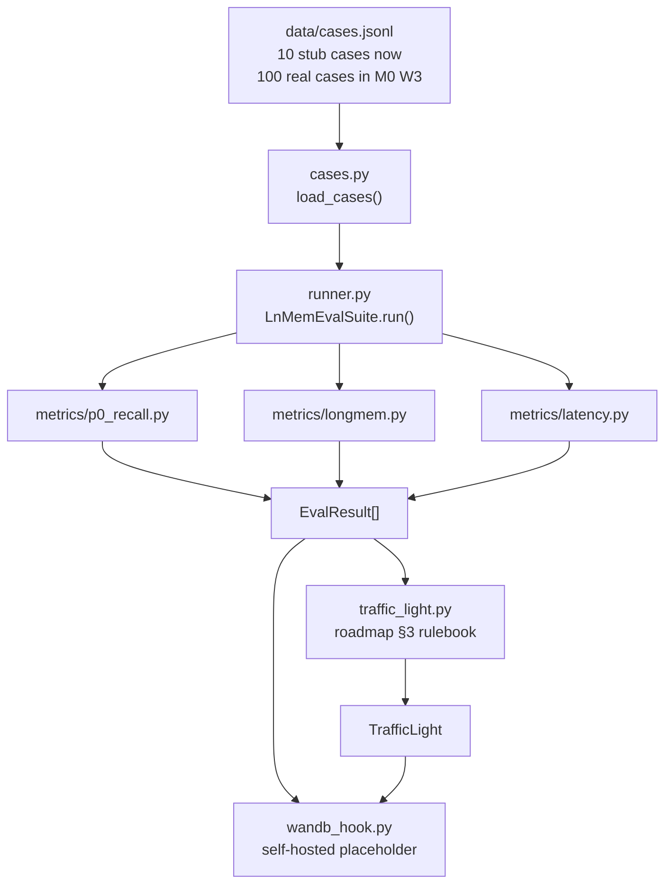

# evals · 中文 LongMemEval + 三色判定骨架

> Codex D scope: only `evals/`.  
> M0 W2-W4 will replace these skeletons with real case generation, metric
> computation, traffic-light aggregation, and self-hosted W&B reporting.

## 1. 模块边界

`evals/` 是 LnMem 的评估套件模块，负责把 100 个中文 LongMemEval 风格
case 跑成 `contracts.protocols.EvalResult`，并根据 roadmap §3 生成
`contracts.protocols.TrafficLight`。

本骨架阶段只做四件事：

1. 固定文件布局，让 cc 能看到 M0-W4 的落点。
2. 对齐 `contracts.protocols.EvalSuite` 的两个方法签名。
3. 放入 10 条 stub JSONL case，先覆盖四类题型。
4. 明确 TODO、阈值来源、W&B PII 边界和 self-review 风险。

本模块不能做的事：

1. 不修改 `contracts/`、`docs/`、`roadmap/`、其他 codex 模块。
2. 不假装完成 metric 计算。
3. 不把 stub case 当作真实 100 题通过率。
4. 不把任何原始用户文本、音视频、截图 bytes 上报到 W&B。

## 2. 架构图



## 3. 数据流

1. `cases.py` 从 `evals/data/cases.jsonl` 读取 stub case。
2. 每条 JSONL 转换成 `EvalCase`。
3. `setup_events` 必须转换成 `EventTensor`。
4. `runner.py` 后续会把 `setup_events` 注入被测记忆系统。
5. 被测系统返回候选 event id、答案或延迟。
6. 三个 metric 文件分别输出 `EvalResult`。
7. `traffic_light.py` 汇总 milestone 级别风险。
8. `wandb_hook.py` 只接收聚合指标和脱敏 details。

## 4. 100 题规划

| 类别 | 数量 | 目标 | stub 覆盖 |
|------|------|------|-----------|
| 单事件 | 30 | 单个 P0/P1 事件可被自然语言找回 | 3 条 |
| 多跳 | 30 | 查询需要跨事件关系或上下文链路 | 3 条 |
| 时间感知 | 30 | 处理昨晚、上周、30 分钟窗口等时间条件 | 2 条 |
| 拒绝幻觉 | 10 | 没有证据时必须拒答或返回空 | 2 条 |

M0 W3 才填真实 100 题。当前 10 条只是 schema 和 runner 的占位样本。

## 5. 接口签名表

| 文件 | API | 签名 | 当前行为 |
|------|-----|------|----------|
| `runner.py` | `LnMemEvalSuite.run` | `Sequence[EvalCase] -> List[EvalResult]` | `NotImplementedError` |
| `runner.py` | `LnMemEvalSuite.traffic_light` | `Sequence[EvalResult], str -> TrafficLight` | `NotImplementedError` |
| `cases.py` | `load_cases` | `str | Path -> List[EvalCase]` | 加载 stub JSONL |
| `traffic_light.py` | `build_traffic_light` | `Sequence[EvalResult], str -> TrafficLight` | `NotImplementedError` |
| `metrics/p0_recall.py` | `P0RecallMetric.score` | `EvalCase, Sequence[str] -> EvalResult` | `NotImplementedError` |
| `metrics/longmem.py` | `LongMemAccuracyMetric.score` | `EvalCase, str -> EvalResult` | `NotImplementedError` |
| `metrics/latency.py` | `LatencyMetric.score` | `EvalCase, float -> EvalResult` | `NotImplementedError` |
| `wandb_hook.py` | `WandbHook.log_case_result` | `EvalResult -> None` | `NotImplementedError` |
| `wandb_hook.py` | `WandbHook.log_traffic_light` | `TrafficLight -> None` | `NotImplementedError` |

## 6. 关联 contracts 类型

本模块只引用以下 contracts 类型：

1. `contracts.protocols.EvalSuite`
2. `contracts.protocols.EvalCase`
3. `contracts.protocols.EvalResult`
4. `contracts.protocols.TrafficLight`
5. `contracts.event_tensor.EventTensor`
6. `contracts.event_tensor.SlotValue`
7. `contracts.schema_v1.SlotID`
8. `contracts.schema_v1.P0_SLOTS`

## 7. 关键设计决策

### 7.1 EvalSuite 是唯一对外主入口

`LnMemEvalSuite` 对齐 `EvalSuite` Protocol。后续 agent_core 或 CI 只需要依赖
`EvalSuite.run()` 和 `EvalSuite.traffic_light()`，不用知道内部 metric 文件布局。

### 7.2 JSONL case 先稳定格式

stub case 用 JSONL，是为了后续让人工标注、脚本生成和 diff review 更容易。
真实 100 题填充时，每行仍然只描述一个 `EvalCase`。

### 7.3 指标拆文件

P0 召回、LongMem 准确率、延迟是不同错误模型。拆文件能避免一个 runner 同时承担
注入、查询、判分、阈值、上报五类责任。

### 7.4 三色阈值引用 roadmap

三色规则来自 `roadmap/milestones.md` §3：

| milestone | 红区 | 黄区 | 绿区 |
|-----------|------|------|------|
| M1 | P0 < 60% 或 Graphiti 不可用或 pipeline 没跑通 | P0 60-80% / Graphiti F1 < 0.5 / pipeline 质量不稳 | 全部达标 |
| M2 | LNN 发散或事件分割 F1 < 0.3 | LNN 弱可用 / 事件分割 F1 0.3-0.5 | 全部达标 |
| M3 | 进度滞后 > 50% | 进度滞后 30-50% | 滞后 < 30% |

实现时必须重新读取 roadmap 的真实数字，不能只相信本 README。

### 7.5 W&B 默认 self-hosted

`WandbHook` 的默认姿态是 self-hosted placeholder。真实启用前必须做字段白名单：
case id、metric、score、passed、threshold、聚合 latency 可以上报；原始 query、
raw modalities、用户文本、音视频 bytes、截图 bytes 不上报。

### 7.6 拒绝幻觉是单独类别

10 条拒绝幻觉题不能和普通召回题混合算准确率。它的核心是“没有证据时不编造”，
后续 longmem metric 需要单独记录拒答正确率。

## 8. M0 W2 TODO

1. 接入真实被测 backend 接口，不在 runner 内写死实现。
2. 确定 `retrieved_event_ids`、自然语言答案、latency 的统一 result envelope。
3. 为 10 条 stub case 建最小端到端 fixture。
4. 给 P0 recall metric 写边界测试：空答案、重复答案、超集答案、顺序无关。
5. 给 latency metric 明确单位统一为毫秒。

## 9. M0 W3 TODO

1. 把 10 条 stub 扩到 100 条中文 LongMemEval 风格 case。
2. 保持 30/30/30/10 分布。
3. 加入 30 分钟窗口内逐句精确匹配 case。
4. 加入 Graphiti 中文 entity F1 相关 details 字段。
5. 启用 W&B self-hosted hook，但只上报白名单字段。
6. 把拒绝幻觉 case 的 expected shape 固化。

## 10. M0 W4 TODO

1. 将 runner 接入 CI 或本地 `pytest` integration marker。
2. 根据真实返回结构完成三色判定。
3. 和 synthetic/parser/Graphiti 三路模块做契约对齐 gate。
4. 输出 milestone report 模板。
5. 将失败 case 落盘为可复现 JSONL。
6. 加入人工复核入口，避免自动指标掩盖语义错误。

## 11. tests 约定

`tests/test_smoke.py` 只验证导入和 Protocol 形状。  
`tests/test_evals_skeleton.py` 保留至少 3 个 case 名，全部 `pytest.skip`。

当前验收命令：

```bash
pytest --collect-only evals/
```

## 12. self-review：5 个最容易翻车的点

1. 阈值硬编码漂移：README、代码、roadmap 三处数字可能不一致。
2. metric 口径漂移：P0 recall、LongMem accuracy、拒绝幻觉拒答率混成一个 score。
3. stub case 不可比：10 条 stub 过了不代表真实 100 题任何能力。
4. W&B 泄漏 PII：query、raw_text、raw_modalities、用户 id 原样上报会踩红线。
5. Protocol 假兼容：runtime_checkable 只能检查方法存在，不能证明签名和语义正确。

## 13. 后续验收口径

1. collect-only 必须 0 error。
2. 单文件必须不超过 200 行。
3. `git diff --name-only` 只能出现 `evals/` 下文件。
4. `contracts/` 不改字段、不改 Protocol。
5. 三色判定进入红区时必须停下问老板。

## Summary

`evals/` 当前是 M0 W2 骨架。  
真实评估、真实阈值执行、真实 W&B 上报都留到 M0 W2-W4。  
对外契约只对齐 `contracts.protocols.EvalSuite`。  
