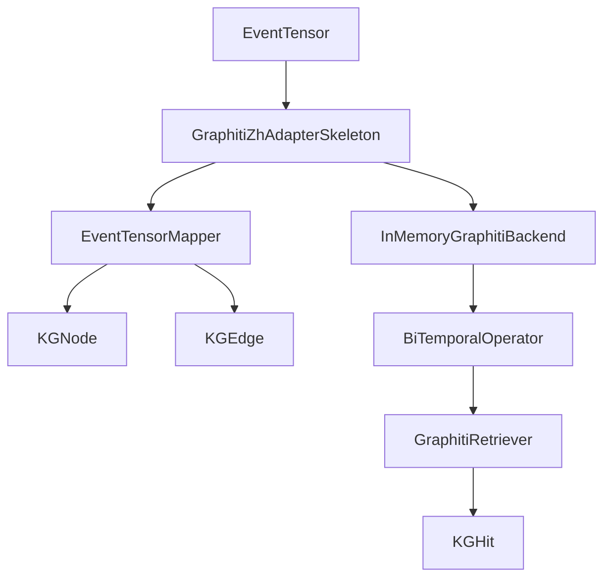

# graphiti_zh_adapter

LnMem M0 的中文 Graphiti 适配层。
Phase A 目标不是接 `graphiti-core`，而是先把 `EventTensor -> KGNode/KGEdge -> InMemory query` 路径跑通，给端到端 demo 提供可验证的最小 KG。

## RULE-ID 索引

| RULE-ID | 约束 | 落点 |
|---|---|---|
| `CONTRACT-GRAPHITI-PROTOCOL` | 只实现 `contracts.protocols.GraphitiZhAdapter`，不改 `contracts/` | `adapter.py` |
| `GRAPHITI-PHASE-A-INMEMORY` | Phase A 只做本地 dict backend，不接 Neo4j / `graphiti-core` | `stub_backend.py` |
| `GRAPHITI-BITEMPORAL-CLOSEDOPEN` | valid-time 语义必须是 `t_valid <= at < t_invalid` | `temporal.py` |
| `GRAPHITI-PHASE-B-CLIENT` | `client.py` 保持 Phase B 占位，避免伪接入外部图存储 | `client.py` |

## Scope

Phase A 已实现：

1. `EventTensorMapper` 把 `EventTensor` 映射成 `KGNode`，节点 id 固定为 `node_{event_id}`。
2. `EventTensorMapper` 从 `RELATED_ENTITIES` / `CAUSAL_LINK` 生成 `mentions` / `causal_link` 边。
3. `InMemoryGraphitiBackend` 支持 `upsert/get/query/invalidate`。
4. `BiTemporalOperator` 支持 UTC 归一化、closed-open valid-time 判断和 active filter。
5. `GraphitiRetriever` 用 `text substring + slot_filter + temporal proximity` 做简化排序。
6. `GraphitiZhAdapterSkeleton` 提供真实可运行的 `upsert/query/invalidate`。

Phase B 明确不做：

1. `graphiti-core` / Neo4j 接入。
2. 中文 entity 抽取（GLiNER）。
3. embedding / cosine 向量检索。
4. BM25 全文索引。
5. `client.py` 真实化。

**Why**：M0 先验证接口闭环和 bi-temporal 语义，比过早引入外部依赖更重要。

## Runtime Path



1. `upsert(event)`:
   - `mapper.to_kg_node(event)`
   - `mapper.to_kg_edges(event)`
   - `backend.upsert_node(node)` + `backend.add_edges(edges)`
2. `query(q)`:
   - `backend.query_candidates(q)` 先按 `user_id` / `slot_filter` / `valid_at` 初筛
   - `temporal.filter_active(...)` 做 closed-open 再过滤
   - `retriever.rank(...)` 输出 `KGHit`
3. `invalidate(event_id, t_invalid)`:
   - backend 仅标记 `t_invalid`，不删除节点/边

**Why**：入口粘合逻辑必须短，才能在 Phase B 替换 backend/client 时保持契约稳定。

## Interface Contract Table

| Class | Method | Signature | Phase A status |
|---|---|---|---|
| `GraphitiZhAdapterSkeleton` | `upsert` | `(event: EventTensor) -> str` | implemented |
| `GraphitiZhAdapterSkeleton` | `query` | `(q: KGQuery) -> List[KGHit]` | implemented |
| `GraphitiZhAdapterSkeleton` | `invalidate` | `(event_id: str, t_invalid: datetime) -> None` | implemented |
| `EventTensorMapper` | `to_kg_node` | `(event: EventTensor) -> KGNode` | implemented |
| `EventTensorMapper` | `to_kg_edges` | `(event: EventTensor) -> List[KGEdge]` | implemented |
| `EventTensorMapper` | `node_to_event` | `(node: KGNode) -> EventTensor` | implemented |
| `InMemoryGraphitiBackend` | `query_candidates` | `(q: KGQuery) -> List[KGNode]` | implemented |
| `BiTemporalOperator` | `filter_active` | `(nodes: List[KGNode], at_time: datetime) -> List[KGNode]` | implemented |
| `GraphitiRetriever` | `rank` | `(candidates: List[KGNode], q: KGQuery) -> List[KGHit]` | implemented |
| `GraphitiClient` | `connect/search/upsert_episode/invalidate_episode` | future boundary | Phase B todo |

## Mapping Notes

| Source | Target | Rule |
|---|---|---|
| `EventTensor.event_id` | `KGNode.node_id` | `node_{event_id}` |
| `EventTensor.timestamp` | `KGNode.t_valid` | exact copy |
| `EventTensor.valid_until` | `KGNode.t_invalid` | exact copy |
| `EventTensor.slots[*].value` | `KGNode.slots[*]` | only persist value layer |
| `SlotID.RELATED_ENTITIES` | `KGEdge(relation=\"mentions\")` | one entity -> one edge |
| `SlotID.CAUSAL_LINK` | `KGEdge(relation=\"causal_link\")` | target `node_{linked_event_id}` |

说明：任务描述中的 `sub_object` 在当前 `schema_v1` 不存在，Phase A 按现有 contract 把 `RELATED_ENTITIES` 解释为 mention 边来源。

**Why**：不能为了满足旧命名而私自扩 `contracts/`，否则会破坏多路并行边界。

## Retrieval Semantics

`KGQuery` 当前支持：

1. `user_id` 必填过滤。
2. `slot_filter` 精确匹配。
3. `valid_at` closed-open bi-temporal 过滤。
4. `text_query` substring 命中任一槽文本记 1.0 分。
5. `slot_filter` 命中记 0.5 分。
6. `temporal proximity` 记 `0.3 / (1 + minutes_delta)`。

总分为三路 weighted sum，默认权重沿用 `vector/bm25/temporal` 三槽命名，但 Phase A 实际语义是 `text/filter/temporal` 的占位实现。

**Why**：保留未来 hybrid retrieval 的接口形状，同时让 Phase A 测试能在无外部依赖下验真。

## Verification

建议命令：

```bash
./.venv-poc-fresh/bin/pytest graphiti_zh_adapter/tests/ -v
PYTHONPATH=. .venv-poc-fresh/bin/pytest poc/tests -q
```

当前 Phase A 新增了 2 个不 skip 的端到端测试：

1. `test_end_to_end_upsert_query_returns_event_within_30min`
2. `test_end_to_end_invalidate_then_query_excludes_event`

## Risks / TODO

1. 节点只持久化 `SlotValue.value`，`confidence/span/raw_text` 还未入图。
2. `mentions` 目标节点还是虚拟 `entity_*` id，没有实体归一化。
3. `score_candidate` 还没有真实向量分或 BM25 分。
4. `invalidate` 只按 `event_id` 更新当前节点/边，不含 transaction time。
5. `client.py` 仍然是明确占位，接真 Graphiti 时要补契约对拍。

**Why**：这些缺口都属于 Phase B 的真实图数据库和检索能力，不应该在 M0 偷偷扩 scope。
