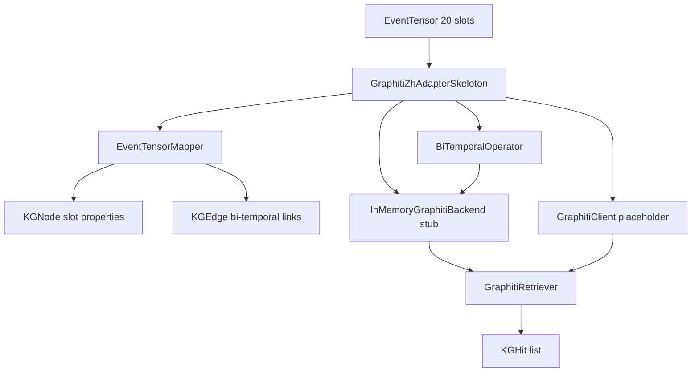

# graphiti_zh_adapter

Codex C module for LnMem M0 W2-W4.

This directory owns the EventTensor to Graphiti bi-temporal KG adapter skeleton.
It is intentionally not a working KG implementation yet.
All behavior methods raise `NotImplementedError("M0 W2 todo: ...")`.

## Scope

The module implements `contracts.protocols.GraphitiZhAdapter`.

Allowed inputs:
- `contracts.event_tensor.EventTensor`
- `contracts.protocols.KGQuery`

Required outputs:
- graph node id string from `upsert`
- `List[contracts.protocols.KGHit]` from `query`
- no return value from `invalidate`

Not in scope:
- installing `graphiti-core`
- calling external KG services
- changing `contracts/`
- changing schema slot definitions
- importing other codex modules

## Architecture



## Runtime Path

1. `upsert(event)` receives a schema-v1 `EventTensor`.
2. `EventTensorMapper.event_to_node` will project all 20 slots to node properties.
3. `EventTensorMapper.event_to_edges` will extract temporal, causal, spatial, and social links.
4. `InMemoryGraphitiBackend` is the v0 fake storage boundary.
5. `GraphitiClient` is the future `graphiti-core` integration boundary.
6. `query(q)` will ask storage for candidates.
7. `GraphitiRetriever` will fuse vector, BM25, and temporal scores.
8. `invalidate(event_id, t_invalid)` will mark records invalid without deleting history.

## File Map

| File | Purpose |
|---|---|
| `adapter.py` | Protocol-facing `GraphitiZhAdapterSkeleton` |
| `mapper.py` | EventTensor to KG node/edge shapes |
| `stub_backend.py` | v0 dict backend boundary without graphiti-core |
| `retriever.py` | KGQuery to KGHit hybrid retrieval surface |
| `temporal.py` | valid-at and invalidation operator surface |
| `client.py` | future graphiti-core wrapper boundary |
| `tests/test_smoke.py` | import and Protocol-shape smoke checks |
| `tests/test_graphiti_zh_adapter_skeleton.py` | collect-only future cases |

## Interface Signature Table

| Class | Method | Signature | M0 status |
|---|---|---|---|
| `GraphitiZhAdapterSkeleton` | `upsert` | `(event: EventTensor) -> str` | raises todo |
| `GraphitiZhAdapterSkeleton` | `query` | `(q: KGQuery) -> List[KGHit]` | raises todo |
| `GraphitiZhAdapterSkeleton` | `invalidate` | `(event_id: str, t_invalid: datetime) -> None` | raises todo |
| `EventTensorMapper` | `event_to_node` | `(event: EventTensor) -> KGNode` | raises todo |
| `EventTensorMapper` | `node_to_event` | `(node: KGNode) -> EventTensor` | raises todo |
| `EventTensorMapper` | `event_to_edges` | `(event: EventTensor, node: KGNode) -> List[KGEdge]` | raises todo |
| `GraphitiRetriever` | `score_candidate` | `(q: KGQuery, node: KGNode) -> CandidateScore` | raises todo |
| `GraphitiRetriever` | `query` | `(q: KGQuery, candidates: List[KGNode]) -> List[KGHit]` | raises todo |
| `BiTemporalOperator` | `normalize_valid_time` | `(value: datetime) -> datetime` | raises todo |
| `BiTemporalOperator` | `is_valid_at` | `(window: TemporalWindow, valid_at: datetime) -> bool` | raises todo |
| `BiTemporalOperator` | `invalidate_window` | `(window: TemporalWindow, t_invalid: datetime) -> TemporalWindow` | raises todo |
| `InMemoryGraphitiBackend` | `upsert_node` | `(node: KGNode) -> str` | raises todo |
| `InMemoryGraphitiBackend` | `add_edges` | `(edges: List[KGEdge]) -> None` | raises todo |
| `InMemoryGraphitiBackend` | `get_node` | `(node_id: str) -> Optional[KGNode]` | raises todo |
| `InMemoryGraphitiBackend` | `query_candidates` | `(q: KGQuery) -> List[KGNode]` | raises todo |
| `InMemoryGraphitiBackend` | `invalidate` | `(event_id: str, t_invalid: datetime) -> None` | raises todo |
| `GraphitiClient` | `connect` | `() -> None` | raises todo |
| `GraphitiClient` | `upsert_episode` | `(node: KGNode, edges: List[KGEdge]) -> str` | raises todo |
| `GraphitiClient` | `search` | `(text: str, valid_at: Optional[datetime]) -> List[str]` | raises todo |
| `GraphitiClient` | `invalidate_episode` | `(event_id: str, t_invalid: datetime) -> None` | raises todo |

## Contract Types

From `contracts.event_tensor`:
- `EventTensor`

From `contracts.protocols`:
- `GraphitiZhAdapter`
- `KGQuery`
- `KGHit`

From `contracts.schema_v1`:
- `SlotID`

The adapter must not define new cross-module schema fields.
If a missing field is found during W2-W4, stop and ask cc before changing `contracts/`.

## KG Shape

`KGNode` is one event node with `node_id`, `event_id`, `user_id`, `t_valid`,
`t_invalid`, `slots`, and `schema_version`.
`slots` is keyed by `SlotID`.
Values should come from `SlotValue.value`.
Confidence, span, and raw text need a W2 decision before storage shape is finalized.

`KGEdge` is one relationship record with `edge_id`, `source_id`, `target_id`,
`relation`, `t_valid`, `t_invalid`, and `evidence_event_id`.
Edges must preserve valid-time history.
Invalidation must not delete old evidence.

## Retrieval Plan

`KGQuery` supports `user_id`, `text_query`, `slot_filter`, and `valid_at`.

The intended candidate flow:
1. Restrict by `user_id`.
2. Apply `slot_filter` for exact slot matches.
3. Apply `valid_at` against `t_valid` and `t_invalid`.
4. Build vector score when event embedding exists.
5. Build BM25 score from text-like slot values.
6. Build temporal score from distance to `valid_at`.
7. Fuse scores by `RetrievalWeights`.
8. Return top `q.top_k` as `KGHit`.

## Temporal Semantics

The intended interval is closed-open:
- valid when `t_valid <= valid_at`
- still valid when `t_invalid is None`
- expired when `valid_at >= t_invalid`

All datetimes must be timezone-aware.
The canonical timezone should be UTC unless cc decides otherwise.

## Key Design Decisions

1. Keep `GraphitiZhAdapterSkeleton` structurally compatible with `GraphitiZhAdapter`.
2. Do not subclass or modify the Protocol.
3. Keep the backend fake and local for M0.
4. Isolate future graphiti-core dependency in `client.py`.
5. Treat EventTensor as the only cross-module event payload.
6. Keep KG node fields close to Graphiti concepts but not Graphiti-specific.
7. Preserve bi-temporal invalidation as metadata, not deletion.
8. Keep retriever scoring explicit for later eval tuning.
9. Leave confidence and raw span storage undecided until W2 implementation.
10. Avoid imports from parser, synth, or eval modules.

## TODO M0 W2-W4

- W2: implement mapper node/edge projection for all 20 slots.
- W2: decide confidence, span, and raw text storage.
- W2: implement in-memory backend write/read/filter behavior.
- W2: implement timezone validation and closed-open valid-time filtering.
- W3: add graphiti-core only after cc approval and wire `GraphitiClient`.
- W3: compare stub and real Graphiti behavior on shared fixtures.
- W4: tune vector/BM25/temporal weights against eval cases.
- W4: add Chinese entity F1 probes and 30-minute recall cases.
- W4: fill `KGHit.explanation` with slot/path evidence.
- W4: prepare cc review checklist for the M0 contract gate.

## Self-Review Risks

1. Chinese entity F1 can fall below the roadmap red line if slot text is treated as raw strings only.
2. Timezone normalization can silently shift valid windows across UTC and Asia/Shanghai.
3. The in-memory stub can pass tests while real Graphiti stores edges differently.
4. Confidence and span metadata can be lost if `SlotValue` is flattened too early.
5. Hybrid scoring can overfit text recall and miss valid temporal matches.

## Verification

Required:

```bash
pytest --collect-only graphiti_zh_adapter/
```

Guard:

```bash
git diff --name-only
```

Expected guard result: only `graphiti_zh_adapter/` paths, no `contracts/` changes,
and every file at or below 200 lines.
