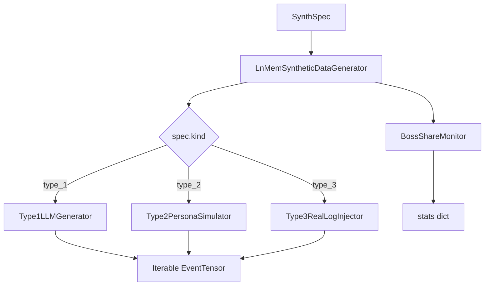

# synthetic_data_generator

> M0 W1 skeleton for `contracts.protocols.SyntheticDataGenerator`.
> 本目录只定义类型 1/2/3 合成数据 pipeline 的骨架，不写真实生成逻辑。

## 0. Scope

本模块负责把 `contracts.protocols.SynthSpec` 路由到三类合成数据来源，并统一输出
`contracts.event_tensor.EventTensor` 序列。

边界：

- 只依赖 `contracts.*` 与本模块内部文件。
- 不 import `openai`、`anthropic` 或其他外部 LLM SDK。
- 不修改 `contracts/`、`docs/`、`roadmap/`、其他 codex 模块。
- 真实实现推迟到 M0 W2-W4；当前所有生成方法必须抛 `NotImplementedError`。

## 1. Architecture

生成链路分三层：

1. `pipeline.py`：唯一对外入口，实现 `SyntheticDataGenerator` Protocol。
2. `generators/*.py`：三类来源的后端骨架，只保留接口与注入点。
3. `monitor.py`：老板真实日志占比监控骨架，服务 roadmap §3.2 红线。

## 2. File Map

| File | Role | M0 W1 status |
| --- | --- | --- |
| `__init__.py` | Public exports | 导出骨架类和配置类型 |
| `config.py` | Shared config, kind constants, LLM fetch type | 只定义 dataclass/enum |
| `pipeline.py` | Protocol implementation and kind routing | route skeleton |
| `monitor.py` | boss_share_cap monitor | API skeleton |
| `generators/type1_llm.py` | LLM auto-filled grammar samples | backend skeleton |
| `generators/type2_persona_sim.py` | 50 personas x 30 days simulation | backend skeleton |
| `generators/type3_real_log.py` | real log injection | backend skeleton |
| `tests/test_smoke.py` | import and Protocol compatibility smoke | collect/pass ready |
| `tests/test_synthetic_data_generator_skeleton.py` | future behavior cases | skipped placeholders |

## 3. contracts.* Types

本模块引用的 contracts 类型：

- `contracts.protocols.SynthSpec`
- `contracts.protocols.SyntheticDataGenerator`
- `contracts.event_tensor.EventTensor`
- `contracts.event_tensor.SlotValue`
- `contracts.schema_v1.SCHEMA_V1`
- `contracts.schema_v1.SlotID`
- `contracts.schema_v1.SlotPriority`

`EventTensor` 是跨模块唯一事件载体。生成器内部可以有 persona、source、monitor
等辅助结构，但不得把这些内部结构泄漏给 parser、KG adapter 或 evals。

## 4. Interface Table

| Component | Signature | Status |
| --- | --- | --- |
| `LnMemSyntheticDataGenerator.generate` | `generate(self, spec: SynthSpec) -> Iterable[EventTensor]` | route then todo |
| `LnMemSyntheticDataGenerator.stats` | `stats(self) -> dict` | todo |
| `Type1LLMGenerator.generate` | `generate(self, spec: SynthSpec) -> Iterable[EventTensor]` | todo |
| `Type2PersonaSimulator.generate` | `generate(self, spec: SynthSpec) -> Iterable[EventTensor]` | todo |
| `Type3RealLogInjector.generate` | `generate(self, spec: SynthSpec) -> Iterable[EventTensor]` | todo |
| `BossShareMonitor.observe` | `observe(self, events: Iterable[EventTensor], source: str) -> BossShareSnapshot` | todo |
| `BossShareMonitor.assert_within_cap` | `assert_within_cap(self, spec: SynthSpec) -> None` | todo |
| `BossShareMonitor.stats` | `stats(self) -> dict` | todo |

## 5. Type 1: LLM Auto Generation

目标：让 LLM 根据 `SCHEMA_V1` 自动生成万能语法槽位填充样本。

M0 W1 只保留两个关键注入点：

- `fetch_impl`：由调用方注入 LLM client 函数，默认 `None`。
- `SyntheticGeneratorConfig`：控制 batch、schema version、strict schema 等通用选项。

W2 真实实现要补：

- schema-guided prompt 模板。
- 20 槽覆盖策略，至少优先覆盖 P0。
- prompt 输入与 `SlotValue` 输出校验。
- LLM 返回 JSON 的解析与错误隔离。
- seed 可复现实验记录。

## 6. Type 2: Persona Simulation

目标：生成 50 个虚拟主人、连续 30 天、多轮中文生活/工作/关系场景。

骨架中保留：

- `VirtualPersona` dataclass。
- `PersonaDayPlan` dataclass。
- `Type2PersonaSimulator.generate` 后端入口。

W2-W3 真实实现要补：

- persona pool 装载与 seed 派生。
- 每日行为时间线生成。
- 多轮对话上下文生成。
- P0/P1 槽位最低填充约束。
- 与 `SynthSpec.persona_pool` 的优先级规则。

## 7. Type 3: Real Log Injection

目标：把老板和种子用户真实日志转成 EventTensor 样本，但受占比红线约束。

骨架中保留：

- `RealLogSource` dataclass。
- `Type3RealLogInjector.generate` 后端入口。
- 与 `BossShareMonitor` 的协作边界。

W3-W4 真实实现要补：

- `real_log_path` 路径解析。
- 日志来源标记：boss / seed_user / other。
- 脱敏策略与隐私级别槽位。
- 注入前的 boss_share_cap 检查。
- 注入后的统计回填。

## 8. boss_share_cap Monitor

`SynthSpec.boss_share_cap` 默认是 `0.5`。roadmap §3.2 的红线语义是：

- 老板贡献占比不得超过 50%。
- 超线时自动暂停真实日志注入。
- monitor 需要能被 evals 读取当前累计统计。

M0 W1 不实现计算，只定义：

- `BossShareSnapshot`：快照字段。
- `BossShareMonitor.observe`：未来记录一批事件来源。
- `BossShareMonitor.assert_within_cap`：未来在 type_3 注入前检查。
- `BossShareMonitor.stats`：未来返回 `SyntheticDataGenerator.stats()` 的一部分。

## 9. Key Decisions

1. `kind` 使用字符串常量，不新增 contracts enum。
2. pipeline 持有三个 backend，避免三类来源互相 import。
3. LLM client 通过 `fetch_impl` 注入，不绑定 provider。
4. `EventTensor` 构造推迟到后端真实实现，M0 不造假样本。
5. monitor 与 type_3 解耦，后续 evals 可以单独读取统计。
6. 配置 dataclass 只描述控制面，不改 `SynthSpec`。
7. 测试以 collect-only 和 Protocol 兼容为主，不提前承诺行为。

## 10. TODO: M0 W2

- 实现 type_1 prompt builder。
- 实现 LLM response parser。
- 添加 P0 槽位完整性校验。
- 给 `fetch_impl` 设计最小请求/响应约定。
- 为 type_1 增加 deterministic fake fetch 单测。
- 定义 `NotImplementedError` 替换顺序，先 type_1 后 type_2。

## 11. TODO: M0 W3

- 实现 persona seed 派生。
- 扩展 `VirtualPersona` 至 50 人池。
- 实现 30 天行为 timeline。
- 将 timeline 转换成中文自然语言事件。
- 将事件转成 `EventTensor`。
- 添加 persona 分布统计。

## 12. TODO: M0 W4

- 实现 real log reader。
- 实现敏感字段脱敏。
- 实现 boss_share_cap 计算。
- 超线时暂停 type_3 注入。
- 将 monitor stats 接入 pipeline stats。
- 补充端到端合成数据样例测试。

## 13. Self-review: 5 Failure Points

1. `SynthSpec.kind` 是自由字符串，拼写错误会在运行期才暴露。
2. type_1 LLM JSON 解析很容易生成不符合 20 槽 schema 的伪样本。
3. type_2 persona 池如果过窄，会污染 LongMemEval 的泛化判断。
4. type_3 真实日志如果未脱敏或未限占比，会直接违反红线。
5. monitor 统计如果只看 batch 而不看累计值，会让 boss_share_cap 失效。

## 14. Testing Contract

当前必须满足：

- `pytest --collect-only synthetic_data_generator/` 0 错误。
- smoke 能 import `contracts.*`。
- smoke 能验证实现类结构兼容 `SyntheticDataGenerator`。
- future behavior tests 用 `pytest.skip` 保留 case 名。
- `git diff --name-only` 只出现 `synthetic_data_generator/` 下路径。

## 15. Out of Scope

以下事项不在 Codex A 当前交付中：

- 修改 `contracts.protocols.SynthSpec` 字段。
- 修改 `contracts.event_tensor.EventTensor`。
- 修改 `contracts.schema_v1.SCHEMA_V1`。
- 调整 roadmap §3.2 或 docs §10.1 红线。
- 真实调用 LLM provider。
- 读取真实老板日志。
- 写 evals 或 graphiti adapter。

## 16. Implementation Notes

`LnMemSyntheticDataGenerator` 的构造函数接受 backend override，方便 W2-W4 用 fake
backend 做单测。默认 backend 都是本目录内的 skeleton backend。

`Type1LLMGenerator` 保留 `fetch_impl=None`，这避免 M0 在没有密钥、没有 provider
选择时提前形成错误依赖。

`Type2PersonaSimulator` 的 persona dataclass 只表达未来需要的稳定字段，不导入
`spikes/ncps_tau_bias/synthetic_personas.py`。

`Type3RealLogInjector` 接受 monitor，但真实日志处理仍全部延期。

## 17. Summary

本目录是 M0 W1 架构骨架。
Protocol 对齐 `contracts.protocols.SyntheticDataGenerator`。
类型 1/2/3 后端已分层但未实现。
boss_share_cap monitor 已留出 API。
真实生成、脱敏、统计、LLM 解析都留给 M0 W2-W4。
