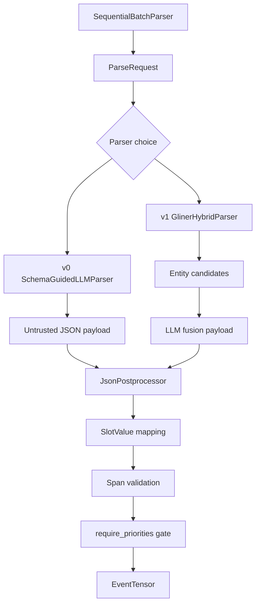

# universal_grammar_parser

Codex B module for LnMem M0: Chinese text to the 20-slot EventTensor skeleton.

This directory owns only parser scaffolding. It must not change `contracts/`,
`docs/`, `roadmap/`, `CLAUDE.md`, or any sibling module.

## Scope

- Input: `contracts.protocols.ParseRequest`
- Output: `contracts.event_tensor.EventTensor`
- Contract: `contracts.protocols.UniversalGrammarParser`
- Schema: `contracts.schema_v1.SCHEMA_V1`
- Stage: M0 W2-W4 skeleton, no production parsing

## Architecture

## File Map

| File | Role |
| --- | --- |
| `__init__.py` | Public exports for the package. |
| `config.py` | Backend enum and parser runtime config. |
| `types.py` | Raw backend DTOs before EventTensor mapping. |
| `parser_v0_llm.py` | v0 schema-guided LLM parser skeleton. |
| `parser_v1_gliner.py` | v1 GLiNER + LLM fusion parser skeleton. |
| `postprocess.py` | JSON decoding, SlotValue mapping, span checks, priority gate. |
| `batch.py` | Sequential batch adapter. |
| `tests/test_smoke.py` | Import and Protocol surface smoke tests. |
| `tests/test_universal_grammar_parser_skeleton.py` | Collect-only future behavior cases. |

## Contract Types

| Type | Source | Usage |
| --- | --- | --- |
| `ParseRequest` | `contracts.protocols` | Parser input for single and batch calls. |
| `UniversalGrammarParser` | `contracts.protocols` | Required method surface. |
| `EventTensor` | `contracts.event_tensor` | Parser output object. |
| `SlotValue` | `contracts.event_tensor` | Postprocessed slot value target. |
| `SlotID` | `contracts.schema_v1` | Slot identity in candidates and events. |
| `SlotPriority` | `contracts.schema_v1` | Priority gate helper input. |
| `SCHEMA_V1` | `contracts.schema_v1` | Prompt and validation schema source. |

## Interface Signatures

| Class | Method | Signature |
| --- | --- | --- |
| `SchemaGuidedLLMParser` | `parse` | `(req: ParseRequest) -> EventTensor` |
| `SchemaGuidedLLMParser` | `parse_batch` | `(reqs: Sequence[ParseRequest]) -> List[EventTensor]` |
| `GlinerHybridParser` | `parse` | `(req: ParseRequest) -> EventTensor` |
| `GlinerHybridParser` | `parse_batch` | `(reqs: Sequence[ParseRequest]) -> List[EventTensor]` |
| `SequentialBatchParser` | `parse` | `(req: ParseRequest) -> EventTensor` |
| `SequentialBatchParser` | `parse_batch` | `(reqs: Sequence[ParseRequest]) -> List[EventTensor]` |
| `JsonPostprocessor` | `build_event` | `(req, backend_result) -> EventTensor` |

## v0 Parser Plan

`SchemaGuidedLLMParser` is the first expected implementation path.

It should build a schema-guided prompt from `SCHEMA_V1`, call a configured LLM,
receive untrusted JSON, and send that payload through `JsonPostprocessor`.

The parser must not trust JSON shape just because the prompt asked for it.

The output boundary is always `EventTensor`, never raw JSON.

## v1 Parser Plan

`GlinerHybridParser` is the second expected implementation path.

It should run multilingual GLiNER entity extraction first, convert entities into
`RawSlotCandidate` values, and then ask an LLM to resolve slot semantics.

The fusion step should keep entity spans traceable so later validation can catch
Chinese boundary drift.

## Postprocess Plan

`JsonPostprocessor` owns the risky boundary between model text and contracts.

Responsibilities:

- Decode backend payloads without ad hoc hard parsing.
- Convert raw candidates to `SlotValue`.
- Validate `span` offsets against the source Python string.
- Apply `require_priorities`.
- Build `EventTensor` with original `user_id` and `timestamp`.
- Keep diagnostics available for later review.

## Key Decisions

1. Parser classes subclass `UniversalGrammarParser` for visible alignment.
2. Real SDK clients are not constructor parameters yet.
3. Backend outputs are represented by local DTOs before contract mapping.
4. `require_priorities` is handled after slot mapping, not inside prompts.
5. Span validation lives in postprocess, not model-specific parser code.
6. Batch orchestration is a wrapper, not duplicated in every backend.
7. Config carries fallback order but does not execute fallback yet.
8. Event identity is delegated to `EventTensor` unless contracts later change.
9. Tests intentionally verify collection and method surface only.
10. Placeholder methods raise `NotImplementedError("M0 W2 todo: ...")`.

## TODO M0 W2

- Implement config validation for temperature, retry count, and timeout.
- Build prompt text from all 20 schema slots.
- Define the allowed JSON envelope for LLM output.
- Add robust JSON decoding with explicit error types.
- Add candidate normalization by `SlotID`.
- Add confidence bounds validation before `SlotValue` creation.
- Validate spans against Chinese source text.
- Preserve raw text for UI/debug use.
- Construct `EventTensor` from validated candidates.
- Add fallback when required priority slots are missing.

## TODO M0 W3

- Load GLiNER multilingual model behind a lazy backend boundary.
- Map entity labels to schema slot candidates.
- Add Chinese entity boundary tests.
- Add LLM fusion prompt for GLiNER candidates.
- Add diagnostics for disagreement between GLiNER and LLM.
- Add confidence merge policy.
- Add deterministic retry behavior.
- Add malformed JSON fixtures.
- Add simple golden cases for P0 coverage.
- Add batch order preservation test.

## TODO M0 W4

- Wire v0 and v1 fallback order.
- Decide whether missing P0 slots produce empty events or structured errors.
- Add lightweight metrics for filled priority counts.
- Add regression fixtures for context-window references.
- Add privacy-level defaulting policy.
- Add source modality defaulting policy.
- Add event-level confidence derivation.
- Add eval hooks for LongMemEval-style cases.
- Document operational knobs for model choice.
- Prepare cc contract gate review notes.

## Self-review Risks

1. LLM output may look JSON-like but violate slot shape or confidence bounds.
2. Chinese span offsets may drift because entity boundaries are ambiguous.
3. `require_priorities` can hide useful partial parses if fallback is unclear.
4. GLiNER labels may not map cleanly to the 20-slot schema.
5. Context-window pronoun resolution can leak inferred facts into observed slots.

## Guardrails

- Do not edit `contracts/`.
- Do not invent new SlotID values.
- Do not import sibling modules.
- Do not parse with regex-only shortcuts.
- Do not treat inferred values as observed without marking them later.
- Do not add concurrency before the sequential behavior is tested.

## Test Strategy

M0 tests are collection-first.

`test_smoke.py` imports `contracts.*`, instantiates the v0 parser, and checks the
runtime method surface through a local `runtime_checkable` Protocol mirror.

`test_universal_grammar_parser_skeleton.py` names the future behavior cases and
skips each one with a M0 W2 pending reason.

This lets `pytest --collect-only universal_grammar_parser/` expose the intended
contract without pretending the parser works.
